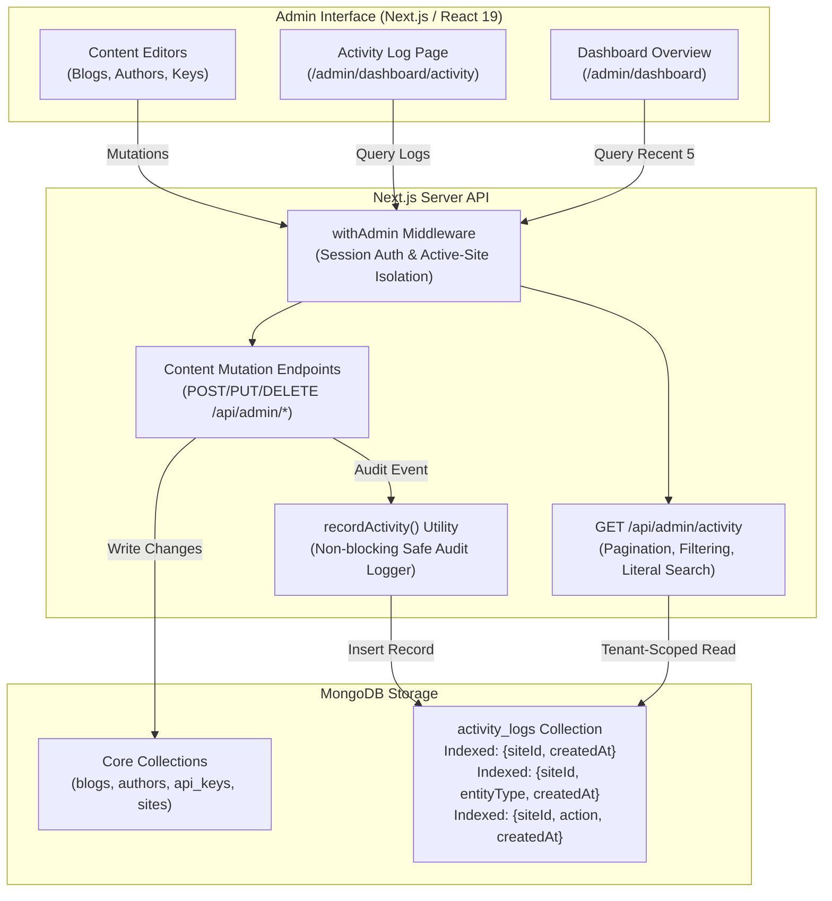

# CogCMS

A self-hostable, multi-site headless CMS built with Next.js 16, React 19, MongoDB/Mongoose, TypeScript and Vitest. Manage blogs, authors, FAQs, whitepapers and release notes in one editorial workspace, and deliver published content to your websites through a versioned API or restricted MongoDB views.

The CMS includes site-scoped users and API keys, editorial previews, stored blog rendering, signed publishing notifications, newsletter and FAQ intake, and optional S3 media uploads. Websites own their presentation. Start with the local demo below or [set up your own installation](docs/DEPLOYMENT.md).

## Local setup

Use Node 22 (`.nvmrc`), npm, **MongoDB 8.2.5** and MongoDB Shell (`mongosh`) for this local recipe. The CMS requires a replica set for transactional paths. Media upload is optional and disabled when the three `S3_*` values are unset.

Get the source and enter the project directory:

```sh
git clone https://github.com/mundra-aman/CogCMS.git
cd CogCMS
```

Then complete these steps from that directory:

1. Create an empty local data directory and start MongoDB with `mongod --replSet rs0 --bind_ip 127.0.0.1 --port 27017 --dbpath <empty-local-directory>`. In a second terminal, connect with `mongosh mongodb://localhost:27017` and run `rs.initiate({_id: 'rs0', members: [{_id: 0, host: 'localhost:27017'}]})` once. Do not point these commands at a shared database.
2. Run `npm ci`, copy `.env.example` to `.env`, and set a new local `CMS_JWT_SECRET` (at least 32 characters) and local `CMS_SEED_ADMIN_PASSWORD` (at least 12 characters). The example email is fictional. Keep `MONGODB_DB_NAME=cms_public_demo` and `MONGODB_URI=mongodb://localhost:27017/?replicaSet=rs0`.
3. Run `npm run seed:admin`, `npm run ensure:indexes`, then `npm run seed:demo`. The demo seed refuses remote MongoDB targets, any database name other than `cms_public_demo`, and an existing site or blog. It creates two fictional sites and 48 blogs; it never overwrites existing records.
4. Run `npm run dev` and open `http://localhost:3003/admin/login`. Sign in with the local admin, then choose **Northstar Studio** or **Harbor Notes** from the site selector. Explore the editors or create a site of your own. The demo has no public website, so its public View links are illustrative.

To reset, stop the app and verify that the target is your disposable local `cms_public_demo` database before dropping it with `mongosh`; then repeat the seed commands. No reset command is bundled so a copied command cannot silently erase another database.

## Feature: Audit Activity Log

An end-to-end audit tracking and compliance system designed for multi-site editorial teams. The Audit Activity Log captures content lifecycle transitions, security events, and administrative operations in real time, exposing them through a filterable dashboard and live activity feed.

### 1. Feature overview

In a multi-tenant CMS with multiple content creators and administrators, teams require clear accountability and operational visibility:
- **The problem:** Prior to this feature, actions such as publishing/unpublishing articles, deleting posts, author modifications, and issuing or rotating API keys left no historical record. Editorial managers could not track who made a change, when it occurred, or what transition took place (e.g. taking a live post offline).
- **The solution:** The Audit Activity Log captures every mutation across blogs, authors, FAQs, API keys, and site configurations. Each event records the actor (ID, name, email, IP), action verb, entity metadata, and timestamp. A dedicated **Activity Log** dashboard and a **Recent Activity** overview feed allow teams to filter by entity type, filter by action, perform literal substring searches, and inspect detailed change metadata.

### 2. Architecture and data flow

The feature integrates into CogCMS's server-driven architecture while maintaining strict multi-tenant site isolation.



#### Data Flow:
1. **Mutation Trigger:** An administrator or editor performs an action (e.g., publishes a draft blog post via `PUT /api/admin/blogs/[slug]`).
2. **Authentication & Scope:** `withAdmin` verifies the session and resolves the active site context (`siteId`).
3. **Database Write & Audit Logging:** The entity is updated, and `recordActivity(...)` asynchronously writes an immutable audit record to the `activity_logs` collection.
4. **Tenant-Safe Querying:** `GET /api/admin/activity` enforces active-site scoping, validates pagination and search parameters, applies compound index-optimized filters, and returns paginated results.
5. **Reactive Presentation:** The Admin Activity Log page displays color-coded badges, relative timestamps, quick links to post editors, and an expandable change detail drawer.

### 3. Design decisions and trade-offs

- **Non-blocking logging vs. Distributed transactions:**
  - *Decision:* `recordActivity` operates with internal error handling so that an unexpected database logging hiccup never aborts a primary user mutation (e.g., publishing an urgent article).
  - *Trade-off:* In an extreme database failure, a content write could succeed while an audit record is omitted. This trade-off prioritizes core CMS availability and performance over strict two-phase locking.
- **Actor snapshotting vs. Normalized relational joins:**
  - *Decision:* In addition to `userId`, each log stores snapshots of `userName` and `userEmail` at the moment of the event.
  - *Trade-off:* Uses slightly more storage per record, but ensures historical audit logs remain legible and accurate even if a user account is deleted, disabled, or renamed years later.
- **Strict active-site isolation:**
  - *Decision:* Every activity log is strictly scoped to `siteId`. Both write paths and read queries reject cross-site parameter overrides.
  - *Trade-off:* Super-admins review activity per-site rather than in a unified multi-tenant stream, preserving strict data segregation boundaries.
- **Literal substring search vs. Arbitrary regular expressions:**
  - *Decision:* Search queries are escaped on the server (`escapeRegex`) so characters like `+`, `*`, and `?` match literally.
  - *Trade-off:* Prevents ReDoS (Regular Expression Denial of Service) and accidental syntax errors while providing intuitive search behavior for editors.

### 4. Technology choices

- **Mongoose & MongoDB:** Model with compound indexes (`{ siteId: 1, createdAt: -1 }`, `{ siteId: 1, entityType: 1, createdAt: -1 }`, and `{ siteId: 1, action: 1, createdAt: -1 }`) ensuring sub-millisecond query performance even with tens of thousands of log records.
- **Next.js 16 App Router & React 19:** Built with modern React patterns including `useTransition` for smooth filter transitions, `AbortController` to cancel superseded network requests, and server-side rendering for the dashboard overview feed.
- **TailwindCSS:** Curated semantic color palettes (`emerald` for published, `amber` for unpublished, `blue`/`indigo` for created, `rose` for deleted, `purple`/`violet` for API keys) for immediate visual recognition.
- **Vitest & MongoMemoryReplSet:** Full suite of isolated unit tests and end-to-end integration tests verifying tenant isolation, filter accuracy, status tracking, and error boundaries.

### 5. Setup and usage

The Activity Log is integrated into the CMS and requires no additional external services or environment variables:
1. Start the CMS:
   ```sh
   npm run dev
   ```
2. Log into the admin workspace (`http://localhost:3003/admin/login`).
3. Select an active site (**Northstar Studio** or **Harbor Notes**).
4. Click **Activity log** in the sidebar navigation (or visit `http://localhost:3003/admin/dashboard/activity`).
5. Perform editorial actions (create or publish a blog, add an author, rotate an API key).
6. Return to the Activity Log or the main Dashboard to inspect the audit stream and view event metadata.

### 6. Limitations and future work

- **CSV / Compliance Export:** Add an export button to stream audit logs as a downloadable CSV for external enterprise compliance audits.
- **Diff Inspector:** Expand the details modal to show side-by-side or inline word diffs for article body changes between revisions.
- **Webhook Alerting:** Enable configurable webhook alerts (e.g., Slack or email notifications) when sensitive actions occur, such as API key revocations or unpublishing high-traffic articles.

## Checks

Run `npm run typecheck`, `npm test`, and `npm run build` sequentially. Unit and integration tests use a separate temporary MongoDB replica set. If its binary is not cached, `mongodb-memory-server` may download one. Report any setup or baseline failure separately from your changes.

## Boundaries

- Admin routes use a login session and active-site selection. `/api/v1` uses site-scoped keys and exposes published content only.
- Website rendering stays in the consumer; this repository owns editorial UI, content models and publication contracts. See [architecture](docs/ARCHITECTURE.md).
- Local editorial use needs no cloud account or paid service. Optional media and hosted installations use your own resources. See [deployment notes](docs/DEPLOYMENT.md).
- Keep credentials out of the repository. `.env.example` contains placeholders only.

Read [CONTRIBUTING.md](CONTRIBUTING.md) to contribute. The optional [assignment](ASSIGNMENT.md) provides a bounded example contribution; it does not define the scope of the product.

## Community and maintenance

- [Support](SUPPORT.md): questions, bug reports and feature requests.
- [Code of Conduct](CODE_OF_CONDUCT.md): participation and reporting concerns.
- [Security policy](SECURITY.md): private vulnerability reporting and maintenance scope.
- [Changelog](CHANGELOG.md): release status and notable changes.

This is the initial public-source preparation. There are no published stability or long-term support guarantees; review the deployment guide before running an installation with real data.

Licensed under the [MIT License](LICENSE), copyright 2026 Aman Mundra. See [source provenance](PROVENANCE.md) for the project's origins. This source distribution includes no private installation history or customer dataset.
